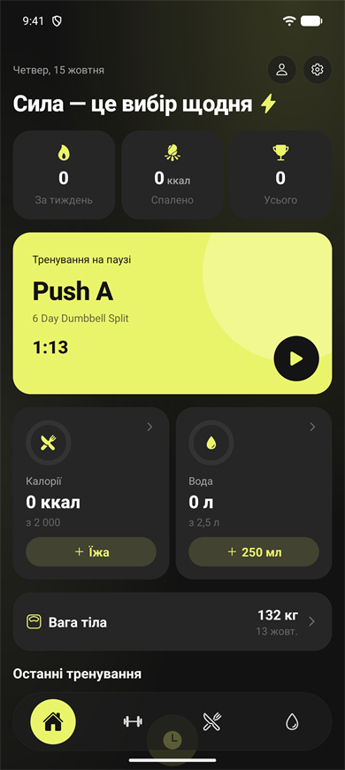
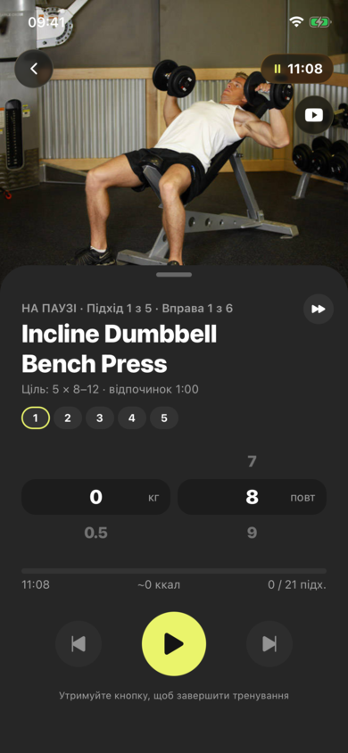
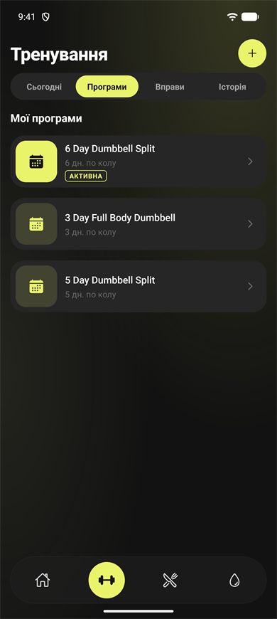
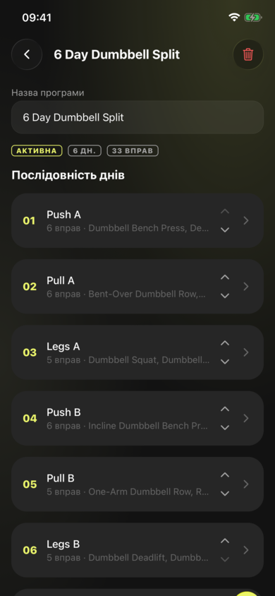
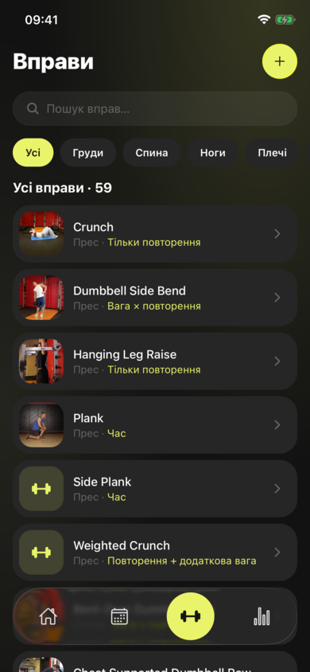
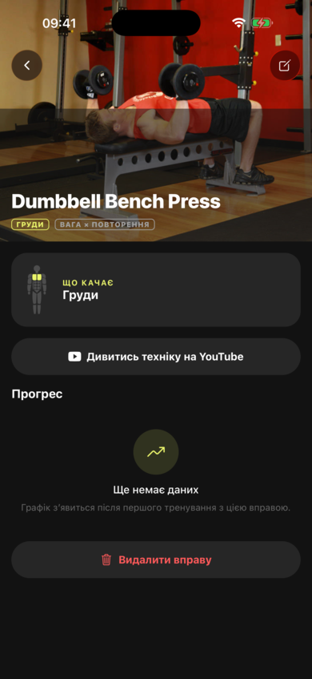
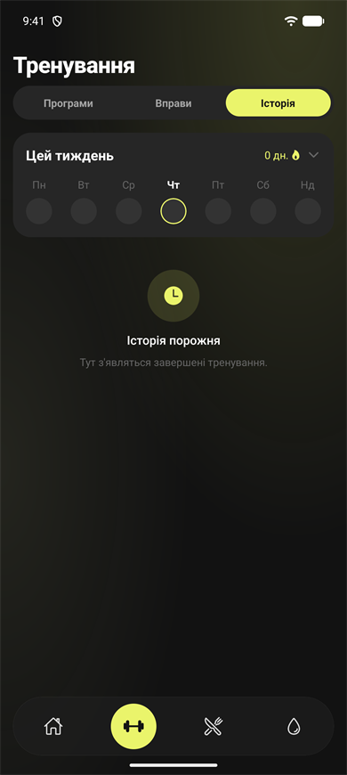
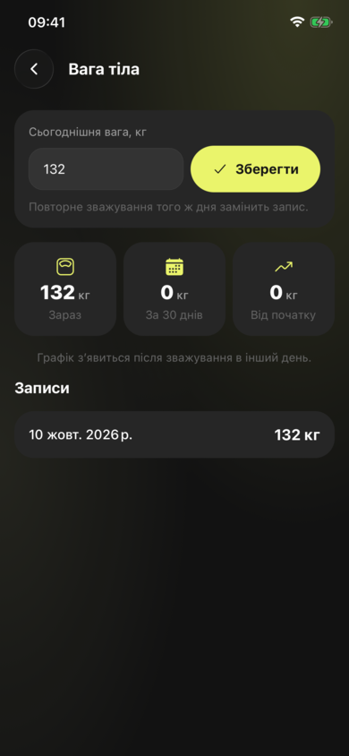
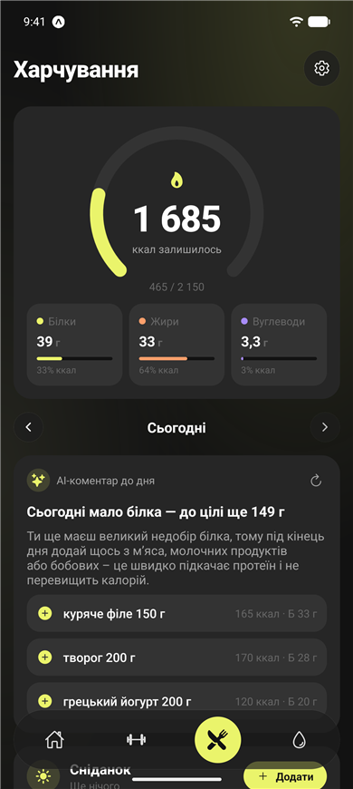
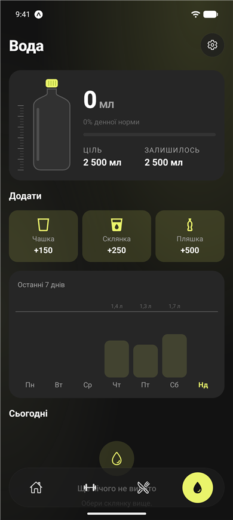

# fitness-app

Особистий фітнес-трекер на React Native (Expo). Усі дані зберігаються локально на пристрої.

- **Тренування** — плеєр: підходи вводяться колесами, як у годиннику iOS, таймер відпочинку з кільцем, пауза / завершення утриманням.
- **Програми** — дні, що йдуть по колу, з цілями: підходи, діапазон повторень, час / дистанція, відпочинок.
- **Вправи** — бібліотека з групами м'язів, фото та відео техніки на YouTube.
- **Прогрес** — історія, «минулого разу», графік по вправі (e1RM для силових), особисті рекорди, календар активності.
- **Вага тіла і калорії** — щоденна вага з графіком, орієнтовні спалені калорії за тренування й тиждень.
- **Харчування** — страви вводяться текстом, калорії й БЖВ рахує AI (Groq, свій ключ у налаштуваннях); уже знайдені страви беруться з локальної бази. Рекомендована калорійність за профілем (зріст, вік, вага, активність).
- **Вода** — денна норма, швидке додавання склянок, графік за тиждень.
- **Apple Health / Health Connect** — підключення в налаштуваннях інтеграцій: вага підтягується в журнал ваги, а прогулянки, біг та інші тренування з годинника — в історію (лише в dev build, не в Expo Go).

## Скріншоти

| Головна | Тренування | Програми | Програма |
|:-:|:-:|:-:|:-:|
|  |  |  |  |

| Вправи | Вправа | Історія | Вага тіла |
|:-:|:-:|:-:|:-:|
|  |  |  |  |

| Харчування | Вода |
|:-:|:-:|
|  |  |

## Стек

Expo SDK 57 · Expo Router · TypeScript · expo-sqlite + Drizzle ORM

## Запуск

```bash
npm install
npx expo start          # Expo Go
npx expo run:ios        # dev build (потрібен Xcode 26.4+)
npm run android         # Expo Go на емуляторі Pixel
npm run android:build   # dev build на емуляторі Pixel
```

## Релізи

Кожен пуш у `main` запускає [release.yml](.github/workflows/release.yml). Якщо нативна частина не змінилась (той самий fingerprint, що й в одного з релізів), JS публікується як OTA-оновлення через EAS Update. Інакше GitHub Actions збирає підписаний APK (без EAS Build) і публікує його як реліз у [fitness-app-releases](https://github.com/varekai-dev/fitness-app-releases). У налаштуваннях застосунок пропонує або встановити OTA-оновлення, або завантажити новий APK.

Локально (потрібні JDK 17+ і Android SDK):

```bash
npm run build:android   # → dist/fitness-<version>.apk
```

Ключ підпису береться з `credentials.json` у корені (як його завантажує `eas credentials -p android`) або зі змінних `ANDROID_KEYSTORE_PATH`, `ANDROID_KEYSTORE_PASSWORD`, `ANDROID_KEY_ALIAS`, `ANDROID_KEY_PASSWORD`. У CI це секрети репозиторію з тими ж назвами, але сам keystore передається в base64 як `ANDROID_KEYSTORE_BASE64`. Плюс `RELEASES_TOKEN` для публікації в репозиторій релізів і `EXPO_TOKEN` для OTA-оновлень.

## Міграції БД

Після зміни `src/db/schema.ts`:

```bash
npx drizzle-kit generate
```

Міграції застосовуються автоматично при запуску застосунку.

## Зображення вправ

Фото вправ у `assets/exercises/` взяті з [free-exercise-db](https://github.com/yuhonas/free-exercise-db) (The Unlicense, public domain).
